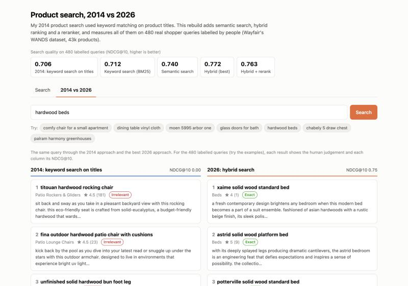
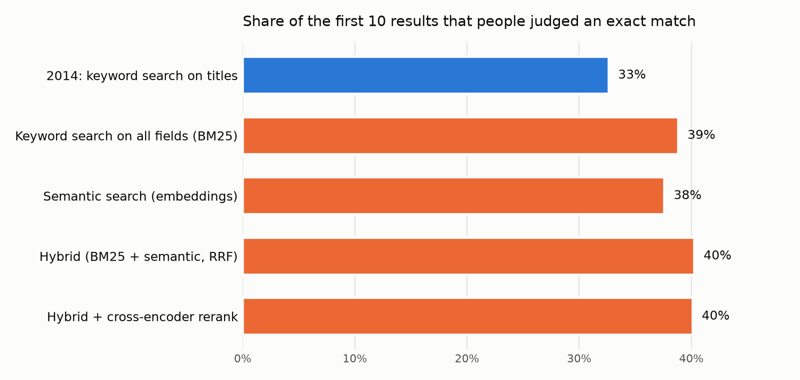

# searchbench

**Product search, 2014 vs 2026: keyword, semantic and hybrid retrieval, measured on 480 real shopper queries that people labelled.**

In 2014 I built a price-comparison search engine for Canadian electronics stores. Scrapy crawled BestBuy.ca, Django stored the products in PostgreSQL, and Haystack indexed them in Elasticsearch, with a faceted Bootstrap front end. That code is preserved in [`legacy/`](legacy/).

In 2026 I rebuilt it to answer one question properly: **how much better does modern search actually get, and how do you know?** The rebuild runs keyword, semantic and hybrid search side by side and scores them against human relevance judgements, the way search teams evaluate ranking changes.

> **Key results** (NDCG@10 on 480 labelled queries, 43k products)
> - **Hybrid search** (keyword + semantic, reciprocal rank fusion) scores **0.772**, against **0.706** for the 2014 approach. It wins on 217 queries and loses on 134.
> - The share of first-page results that people judged an exact match rises from **33% to 40%**, at ~11 ms per query on a laptop.
> - An off-the-shelf **cross-encoder reranker made it slightly worse and 20× slower**, so it's measured but not the default.



*The web app's comparison view. For "hardwood beds", the 2014 approach returns a rocking chair and patio furniture (judged irrelevant); hybrid search returns solid wood beds (judged exact matches).*

## Data

[**WANDS**](https://github.com/wayfair/WANDS), the Wayfair ANnotation DataSet (MIT licence): 42,994 products with names, categories, descriptions and features, 480 real search queries, and 233,448 query-product pairs that people labelled *Exact*, *Partial* or *Irrelevant*.

I moved away from scraping retailers on purpose. A public labelled dataset makes the results reproducible and measurable, and avoids crawling sites whose terms prohibit it.

## Approaches

| Approach | How it works |
|---|---|
| **2014: keyword search on titles** | The 2014 Haystack index template held only the product title (and URL), searched by Elasticsearch. Reproduced as BM25 over titles |
| **Keyword search on all fields** | BM25 (stemmed, stop words removed) over name, product type, category path, description and features |
| **Semantic search** | Each product embedded with [`bge-small-en-v1.5`](https://huggingface.co/BAAI/bge-small-en-v1.5); cosine similarity to the query embedding |
| **Hybrid** | [Reciprocal rank fusion](https://plg.uwaterloo.ca/~gvcormac/cormacksigir09-rrf.pdf) of the keyword and semantic top 100 |
| **Hybrid + rerank** | A cross-encoder ([`ms-marco-MiniLM-L-6-v2`](https://huggingface.co/cross-encoder/ms-marco-MiniLM-L-6-v2)) rescores the hybrid top 50 |

## Results

| Approach | NDCG@10 | Exact matches in top 10 | MRR (first exact match) | Latency |
|---|---:|---:|---:|---:|
| 2014: keyword search on titles | 0.706 | 32.7% | 0.511 | 0.2 ms |
| Keyword search on all fields | 0.712 | 38.9% | 0.565 | 0.3 ms |
| Semantic search | 0.740 | 37.6% | 0.561 | 12 ms |
| **Hybrid** | **0.772** | **40.3%** | **0.602** | **11 ms** |
| Hybrid + rerank | 0.763 | 40.1% | 0.601 | 206 ms |

NDCG@10 uses graded labels (Exact = 1, Partial = 0.5); latency is per query on a MacBook (CPU/MPS). Full table: [`results/summary.md`](results/summary.md).



### What the numbers say

- **Keyword and semantic search fail on different queries, which is why hybrid wins.** Semantic search rescues loose or misspelled phrasing: "chabely 5 **draw** chest" (BM25 0.14, semantic 1.00) and "black fluffy stool" (0.06 → 0.92). Keyword search wins on rare exact names that an embedding blurs: "trinaic towel rod" (1.00 vs 0.20) and "kelly clarkson light fixtures" (0.94 vs 0.42). Fusing the two rankings keeps most of both.
- **The cheapest 2014 fix was indexing more fields.** Searching descriptions and features, not just titles, lifts exact first-page matches from 33% to 39% for almost no cost. The 2014 index template was the bottleneck, not Elasticsearch.
- **A bigger model isn't automatically better.** The reranker was trained on web search (MS MARCO), not furniture, and it slightly lowered quality while multiplying latency by 20. Without the evaluation set, it would have looked like an obvious upgrade.
- **Know what the metric can't see.** WANDS labels were collected from earlier systems' results, so products nobody labelled count as irrelevant. 10–17% of each approach's top 10 is unlabelled ([`results/summary.md`](results/summary.md)), so newer approaches are, if anything, slightly under-credited.

## Web app

A FastAPI backend with a plain HTML/JS front end (no framework, light and dark mode, works on mobile):

- **Search:** pick the approach, filter by product type (facets computed from the results) and by minimum rating.
- **2014 vs 2026:** the same query through both approaches side by side. For the 480 labelled queries it shows each result's human judgement and each column's NDCG@10.
- **Example queries:** the chips are the queries where hybrid search improved most over 2014.

## Run it

```bash
uv venv -p 3.12 && uv pip install -e ".[dev]"
searchbench download      # WANDS, ~96 MB
searchbench eval          # builds indexes (embedding takes a few minutes the first time), scores all approaches
searchbench report        # results/summary.md + chart
searchbench serve         # web app on http://127.0.0.1:8000
pytest                   # unit tests + API tests
```

## Layout

```
src/searchbench/
  data.py         WANDS loader and graded labels
  retrievers.py   2014 title BM25, field BM25, dense, hybrid (RRF), reranker
  evaluate.py     NDCG@10, exact precision@10, MRR, unlabelled share
  web.py          FastAPI: /api/search, /api/compare, /api/meta
  report.py       results table and chart
  cli.py          searchbench download | eval | report | serve
app/static/       the web front end (one HTML file)
legacy/           the 2014 Django + Haystack + Scrapy code
results/          scores per approach and per query
tests/            metrics, retrieval and API tests
```

The 2014 settings file had a database password and Django secret key committed. They now come from environment variables, and the old values are treated as compromised.

## License

MIT. WANDS is © Wayfair, MIT licence.
